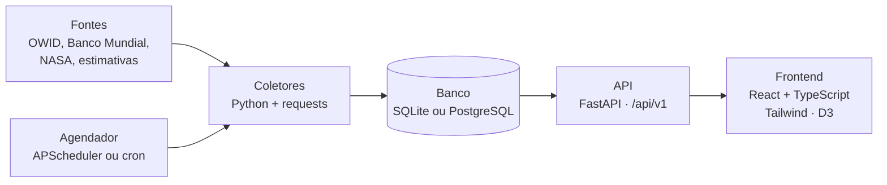

# 🌍 World Data View

**World Data View** é uma plataforma interativa que reúne dados quantitativos sobre o mundo e a humanidade e os mostra em contadores ao vivo, gráficos e mapas. O objetivo é dar a estudantes, professores, jornalistas e curiosos um lugar claro, honesto e citável para olhar os números do planeta.

> **Estado atual: MVP funcional.** Backend, API pública e dashboard estão implementados e testados. Parte das fontes ainda precisa ser validada em produção e alguns números são estimativas ou dados de demonstração. Tudo isso é sinalizado na interface; a seção [Estado dos dados](#-estado-dos-dados) detalha o que é o quê.

---

## ✨ O que já existe

- **Contadores ao vivo**: população mundial com o número correndo na tela, nascimentos e mortes do dia, CO₂ emitido no ano e variação líquida de florestas. Os números são *extrapolações* de dados anuais (o servidor entrega base e ritmo por segundo; o navegador faz a conta). [Como funciona](docs/arquitetura.md#contadores-ao-vivo).
- **Gráficos interativos** com cursor de leitura, tooltip, navegação por teclado, tabela equivalente e download em CSV.
- **Comparação entre países e períodos**: até 4 entidades no mesmo gráfico, atalhos de período (tudo, desde 1950, desde 1990, últimos 10 anos) e modo *Índice 100* para comparar crescimento de entidades de tamanhos muito diferentes.
- **Mapa coroplético por país** com controle de ano, ranking dos maiores valores e clique para comparar.
- **Curiosidade do dia**: um fato por dia, calculado a partir dos dados do banco, nunca texto fixo.
- **API pública** (`/api/v1`, documentada em `/docs`) com histórico filtrável, mapa, comparação e exportação CSV. Veja [docs/api.md](docs/api.md).
- **Tema claro e escuro**, layout responsivo e respeito a `prefers-reduced-motion`.

## 📂 Categorias de dados

| Categoria | Indicadores disponíveis hoje | Fonte |
|---|---|---|
| 📊 **População & Demografia** | População (mundo e países), natalidade, mortalidade | Our World in Data (ONU/WPP), Banco Mundial |
| 🌍 **Planeta & Natureza** | Emissões de CO₂ (total e per capita, mundo e países), anomalia de temperatura, área florestal e variação anual, espécies extintas | Our World in Data / Global Carbon Project, NASA GISTEMP, Banco Mundial, IUCN (estimativa) |
| 📱 **Tecnologia & Internet** | Smartphones em uso, dados gerados na internet por dia | Estimativas editoriais |
| 📚 **Cultura & História** | *Ainda sem indicadores* (livros, filmes, línguas: sem fonte aberta simples) | — |
| ⚠️ **Impactos Sociais** | Pobreza extrema, alfabetização de adultos | Banco Mundial |

Ainda fora do escopo implementado: estimativa de quantas pessoas já viveram, projeções populacionais, fotos tiradas na história, migrações globais e a categoria Cultura. Estão no [roadmap](#-roadmap).

## 🏗 Arquitetura



Uma tabela normalizada (`observations`: indicador, país, ano, valor, fonte) guarda tudo. Adicionar um indicador novo é cadastrá-lo no catálogo e escrever um coletor; não exige migração de schema. Detalhes em [docs/arquitetura.md](docs/arquitetura.md).

### Mudanças em relação ao desenho original

O README original propunha uma stack mais pesada. Ela foi ajustada ao que o projeto realmente precisa hoje:

| Proposta original | O que foi feito | Por quê |
|---|---|---|
| PostgreSQL | **SQLite por padrão**, PostgreSQL por variável de ambiente | O volume é pequeno (dezenas de milhares de linhas). Zero configuração para rodar; Postgres continua suportado. |
| Redis | **Cache em memória** (TTL) | Uma instância só, poucas respostas pesadas. Redis seria uma peça a mais sem ganho. |
| Mapbox | **d3-geo + world-atlas** | Sem chave de API, sem conta, sem custo, e o mapa funciona offline. |
| WebSockets | **Contador calculado no navegador** | O dado de origem muda uma vez por ano; empurrar um número novo por segundo pelo servidor não acrescenta informação. O servidor entrega a base e o ritmo. |
| Cron jobs | **APScheduler no processo da API** (opcional) ou cron externo com a CLI | Funciona sem infraestrutura. Para várias réplicas, use cron. |
| React **ou** Next.js | **React + Vite** | É um painel sem necessidade de renderização no servidor. |
| Chart.js / D3 | **SVG feito à mão com d3-scale/d3-shape** | Controle total de acessibilidade, tooltip e tabela equivalente. |

## 🚀 Como rodar

Requisitos: Python 3.11+ (desenvolvido e testado em 3.13) e Node 22.12+.

```bash
# 1. Backend
cd backend
python -m venv .venv && source .venv/bin/activate
pip install -r requirements-dev.txt

python -m app.cli collect        # coleta dados reais das fontes
python -m app.cli seed-demo      # (opcional) completa o que faltar com dados sintéticos
python -m uvicorn app.main:app --reload    # http://localhost:8000  (docs em /docs)

# 2. Frontend, em outro terminal
cd frontend
npm install
npm run dev                      # http://localhost:5173 (proxy para a API em :8000)
```

> Se `collect` não alcançar alguma fonte (rede bloqueada, fonte fora do ar), a execução termina com aviso, registra o erro e segue com as demais. O painel mostra quais fontes falharam e, se você usou `seed-demo`, marca claramente tudo o que é demonstração.

Testes e verificações:

```bash
cd backend  && python -m pytest             # 66 testes
cd frontend && npm test && npm run build    # 16 testes, checagem de tipos e build
```

Configuração por variáveis `WDV_*`: veja [backend/.env.example](backend/.env.example).

## 📊 Estado dos dados

Esta plataforma existe para ser confiável, então vale ser explícito:

- ✅ **Verificado com dados reais:** população e emissões de CO₂ (mundo e ~220 países) vindos do Our World in Data.
- 🧪 **Implementado e testado só com amostras gravadas:** Banco Mundial (natalidade, mortalidade, floresta, pobreza, alfabetização) e NASA GISTEMP. Os coletores seguem os formatos documentados dessas APIs e têm testes com fixtures, mas **não foram executados contra os servidores reais** no ambiente de desenvolvimento (rede bloqueada). Rode `python -m app.cli collect` no seu ambiente e confira `python -m app.cli status`.
- ⚠️ **Estimativas:** smartphones, dados da internet por dia e espécies extintas vêm de [`reference_estimates.json`](backend/app/data/reference_estimates.json). São valores editoriais herdados do projeto original e **ainda precisam de uma fonte citável** cada um. Aparecem com o selo *estimativa*.
- 🎭 **Demonstração:** `seed-demo` gera séries sintéticas só para os indicadores que não têm nenhum dado, para a interface poder ser avaliada. Tudo que vem delas carrega o selo *demonstração*, inclusive a curiosidade do dia e os contadores. **Não são dados reais.**
- 🔢 **Contadores:** são projeções de taxas anuais, não medições instantâneas.

Fontes, licenças e como cada número é obtido: [docs/fontes-de-dados.md](docs/fontes-de-dados.md).

## 🗺 Roadmap

- **Fase 1 — MVP** ✅ coleta de fontes abertas, banco, API e dashboard com contadores, gráficos, mapa e comparação.
- **Fase 2 — Beta**
  - Validar os coletores do Banco Mundial e da NASA em produção e remover a dependência de dados de demonstração.
  - Dar fonte citável às estimativas de referência.
  - Categoria Cultura & História, migrações (UNHCR), projeções populacionais (ONU/WPP) e "quantas pessoas já viveram".
  - Limite de requisições e chaves opcionais para a API pública.
- **Fase 3 — Lançamento**
  - Visualizações avançadas, mais histórico, publicação (frontend estático + API) e versão mobile/PWA.

## 👥 Público-alvo

Curiosos e entusiastas de estatística, estudantes e professores, jornalistas e criadores de conteúdo, empresas e ONGs.

## 💰 Monetização (ideias futuras)

Plano gratuito com dados básicos, plano premium com relatórios e exportação avançados, licenciamento de dados para empresas e conteúdo patrocinado. Nada disso está implementado.

## 📜 Licença

O projeto será licenciado sob a **MIT License** (a definir). Os dados têm licenças próprias, listadas em [docs/fontes-de-dados.md](docs/fontes-de-dados.md); atribua as fontes ao reutilizá-los.

## 🤝 Contribuições

Contribuições são bem-vindas. Faça um fork, crie sua branch (`git checkout -b feature/nova-funcionalidade`) e abra um pull request. Antes, rode os testes do backend e do frontend. Convenções do projeto em [CLAUDE.md](CLAUDE.md).
