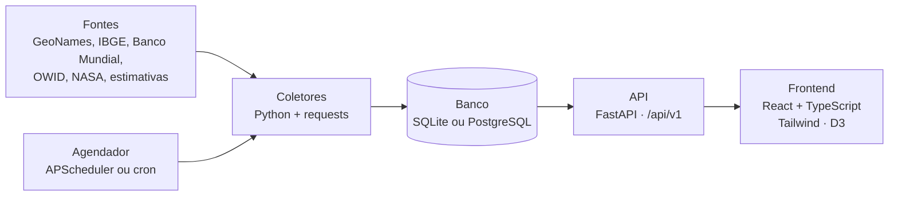

# 🌍 World Data View

**World Data View** é uma plataforma interativa que reúne dados quantitativos sobre o mundo e a humanidade e os mostra em contadores ao vivo, gráficos e mapas. O objetivo é dar a estudantes, professores, jornalistas e curiosos um lugar claro, honesto e citável para olhar os números do planeta.

> **Estado atual: MVP funcional, com lugares.** Backend, API pública e painel estão implementados e testados. Além do mundo e dos países, a plataforma navega por **continentes, estados e cidades**, com 75 indicadores. Alguns números são estimativas, calculados ou de demonstração, e a interface sinaliza cada caso; a seção [Estado dos dados](#-estado-dos-dados) detalha o que é o quê.

---

## ✨ O que já existe

- **Contadores ao vivo**: população mundial com o número correndo na tela, nascimentos e mortes do dia, CO₂ emitido no ano e variação líquida de florestas. Os números são *extrapolações* de dados anuais (o servidor entrega base e ritmo por segundo; o navegador faz a conta). [Como funciona](docs/arquitetura.md#contadores-ao-vivo).
- **Gráficos interativos** com cursor de leitura, tooltip, navegação por teclado, tabela equivalente e download em CSV.
- **Lugares em todos os níveis**: mundo, 6 continentes, ~250 países, estados/regiões e cidades. Cada lugar tem página própria (`#/lugar/BRA-SC`) com trilha de navegação, população, ficha (capital, área, moeda, idiomas...), evolução e ranking dos lugares que o compõem. Uma busca única encontra qualquer um deles.
- **Brasil em detalhe**: as 27 UFs e os 5.571 municípios, com população (estimativas e censos do IBGE), nascimentos, taxa de natalidade e PIB.
- **Comparação entre lugares e períodos**: até 4 lugares no mesmo gráfico (um país, um estado e uma cidade juntos, se quiser), atalhos de período (tudo, desde 1950, desde 1990, últimos 10 anos) e modo *Índice 100* para comparar crescimento de entidades de tamanhos muito diferentes.
- **Mapa coroplético por país** com controle de ano, ranking dos maiores valores e clique para comparar.
- **Curiosidade do dia**: um fato por dia, calculado a partir dos dados do banco, nunca texto fixo.
- **API pública** (`/api/v1`, documentada em `/docs`) com histórico filtrável, mapa, comparação e exportação CSV. Veja [docs/api.md](docs/api.md).
- **Tema claro e escuro**, layout responsivo e respeito a `prefers-reduced-motion`.

## 📂 Categorias de dados

| Categoria | Indicadores | Fonte principal |
|---|---|---|
| 📊 **População & Demografia** (18) | População, natalidade, mortalidade, fecundidade, expectativa de vida (total, feminina, masculina), crescimento, faixas etárias, urbana/rural, densidade, migração líquida e estoque de migrantes; nascimentos e taxa de natalidade do registro civil (Brasil) | OWID, Banco Mundial, IBGE |
| 💰 **Economia & Trabalho** (14) | PIB (nominal e PPC), PIB per capita, crescimento, inflação, desemprego, força de trabalho, comércio, dívida, gasto militar; PIB municipal (Brasil) | Banco Mundial, IBGE |
| 🏥 **Saúde** (10) | Mortalidade infantil, de menores de 5 anos e materna, gasto em saúde, médicos, leitos, vacinação, subnutrição, água e saneamento | Banco Mundial |
| 🎓 **Educação & Ciência** (8) | Alfabetização, matrículas por nível, conclusão do primário, gasto em educação e P&D, artigos científicos | Banco Mundial |
| ⚡ **Energia & Infraestrutura** (4) | Acesso à eletricidade, renováveis, uso de energia per capita | Banco Mundial |
| 🌍 **Planeta & Natureza** (11) | CO₂ (total e per capita), temperatura global, florestas, terras agrícolas, áreas protegidas, poluição do ar, espécies extintas | OWID, NASA GISTEMP, Banco Mundial, IUCN (estimativa) |
| 📱 **Tecnologia & Internet** (5) | Usuários de internet, celulares e banda larga; smartphones e dados por dia (estimativas) | Banco Mundial, estimativas editoriais |
| ⚠️ **Impactos Sociais** (5) | Pobreza extrema e nacional, Gini, homicídios, mulheres no parlamento | Banco Mundial |
| 📚 **Cultura & História** | *Ainda sem indicadores* (livros, filmes, línguas: sem fonte aberta simples) | — |

Cobertura por nível: países, continentes e mundo têm séries históricas de todos os indicadores acima; estados e municípios do **Brasil** têm população, nascimentos, natalidade e PIB; estados/regiões e cidades de **outros países** têm população (um instantâneo do GeoNames, sem ano de referência) e ficha. Veja a tabela completa em [docs/fontes-de-dados.md](docs/fontes-de-dados.md#o-que-existe-em-cada-nível).

Ainda fora do escopo implementado: estimativa de quantas pessoas já viveram, projeções populacionais, fotos tiradas na história, séries de estados e cidades fora do Brasil e a categoria Cultura. Estão no [roadmap](#-roadmap).

## 🏗 Arquitetura



Duas tabelas normalizadas guardam tudo: `places` (mundo, continentes, países, estados e cidades, com hierarquia) e `observations` (indicador, lugar, ano, valor, fonte). Continentes são calculados a partir dos países, com regras de cobertura declaradas. Adicionar um indicador novo é cadastrá-lo no catálogo (os do Banco Mundial só precisam do código); não exige migração de schema. Detalhes em [docs/arquitetura.md](docs/arquitetura.md).

### Mudanças em relação ao desenho original

O README original propunha uma stack mais pesada. Ela foi ajustada ao que o projeto realmente precisa hoje:

| Proposta original | O que foi feito | Por quê |
|---|---|---|
| PostgreSQL | **SQLite por padrão**, PostgreSQL por variável de ambiente | O volume é pequeno (dezenas de milhares de linhas). Zero configuração para rodar; Postgres continua suportado. |
| Redis | **Cache em memória** (TTL) | Uma instância só, poucas respostas pesadas. Redis seria uma peça a mais sem ganho. |
| Mapbox | **d3-geo + world-atlas** | Sem chave de API, sem conta, sem custo, e o mapa funciona offline. |
| WebSockets | **Contador calculado no navegador** | O dado de origem muda uma vez por ano; empurrar um número novo por segundo pelo servidor não acrescenta informação. O servidor entrega a base e o ritmo. |
| Cron jobs | **APScheduler no processo da API** (opcional) ou cron externo com a CLI | Funciona sem infraestrutura. Para várias réplicas, use cron. |
| React **ou** Next.js | **React + Vite** | É um painel sem necessidade de renderização no servidor. |
| Chart.js / D3 | **SVG feito à mão com d3-scale/d3-shape** | Controle total de acessibilidade, tooltip e tabela equivalente. |

## 🚀 Como rodar

Requisitos: Python 3.11+ (desenvolvido e testado em 3.13) e Node 22.12+.

```bash
# 1. Backend
cd backend
python -m venv .venv && source .venv/bin/activate
pip install -r requirements-dev.txt

python -m app.cli collect        # coleta dados reais das fontes (a primeira carga completa é pesada: veja abaixo)
python -m app.cli seed-demo      # (opcional) completa o que faltar com dados sintéticos
python -m uvicorn app.main:app --reload    # http://localhost:8000  (docs em /docs)

# 2. Frontend, em outro terminal
cd frontend
npm install
npm run dev                      # http://localhost:5173 (proxy para a API em :8000)
```

> A coleta completa baixa o GeoNames, os 5.571 municípios do IBGE e 64 indicadores do Banco Mundial para ~220 países: leva cerca de 3 minutos com boa rede (medido num runner real em 13/11/2026) e gera um banco SQLite de ~200 MB. Para mexer só na interface, `python -m app.cli collect --only geonames owid aggregates` (menos de 1 minuto) e `seed-demo` bastam.
>
> Se `collect` não alcançar alguma fonte (rede bloqueada, fonte fora do ar), a execução termina com aviso, registra o erro e segue com as demais. O painel mostra quais fontes falharam e, se você usou `seed-demo`, marca claramente tudo o que é demonstração.

Testes e verificações:

```bash
cd backend  && python -m pytest             # 122 testes
cd backend  && ruff check app tests
cd frontend && npm test && npm run build    # 49 testes, checagem de tipos e build
```

Configuração por variáveis `WDV_*`: veja [backend/.env.example](backend/.env.example).

## 📊 Estado dos dados

Esta plataforma existe para ser confiável, então vale ser explícito:

- ✅ **Dados reais:** população e emissões de CO₂ (mundo e ~220 países) do Our World in Data; 64 indicadores por país do Banco Mundial; população, nascimentos e PIB de UFs e municípios do IBGE; lugares e fichas do GeoNames.
- 🧮 **Calculados:** continentes (e o mundo, onde a fonte não traz) são somas ou médias ponderadas dos países, só quando os países informantes cobrem quase toda a população do grupo. A interface os marca como *calculado*.
- 📍 **Populações de cidades fora do Brasil** vêm do GeoNames como instantâneo, **sem ano de referência**, e podem diferir de censos oficiais.
- ✅ **Verificado contra os servidores reais** (em 13/11/2026, num runner do GitHub): GeoNames, IBGE, Banco Mundial, NASA GISTEMP e OWID. Rode `python -m app.cli collect` e `status` no seu ambiente para repetir.
- ⚠️ **Estimativas:** smartphones, dados da internet por dia e espécies extintas vêm de [`reference_estimates.json`](backend/app/data/reference_estimates.json). São valores editoriais herdados do projeto original e **ainda precisam de uma fonte citável** cada um. Aparecem com o selo *estimativa*.
- 🎭 **Demonstração:** `seed-demo` gera séries sintéticas só para os indicadores que não têm nenhum dado, para a interface poder ser avaliada. Tudo que vem delas carrega o selo *demonstração*, inclusive a curiosidade do dia e os contadores. **Não são dados reais.**
- 🔢 **Contadores:** são projeções de taxas anuais, não medições instantâneas.

Fontes, licenças e como cada número é obtido: [docs/fontes-de-dados.md](docs/fontes-de-dados.md).

## 🗺 Roadmap

- **Fase 1 — MVP** ✅ coleta de fontes abertas, banco, API e dashboard com contadores, gráficos, mapa e comparação.
- **Fase 1.5 — Lugares e métricas** ✅ continentes, estados e cidades, busca, página por lugar, Brasil em detalhe (IBGE) e 75 indicadores em 8 categorias.
- **Fase 2 — Beta**
  - Substituir os dados de demonstração por coleta real em produção (os coletores já foram validados contra as fontes).
  - Dar fonte citável às estimativas de referência.
  - Séries históricas de estados e cidades de outros países (Eurostat, US Census e equivalentes, país a país).
  - Categoria Cultura & História, migrações (UNHCR), projeções populacionais (ONU/WPP) e "quantas pessoas já viveram".
  - Limite de requisições e chaves opcionais para a API pública.
- **Fase 3 — Lançamento**
  - Visualizações avançadas, mais histórico, publicação (frontend estático + API) e versão mobile/PWA.

## 👥 Público-alvo

Curiosos e entusiastas de estatística, estudantes e professores, jornalistas e criadores de conteúdo, empresas e ONGs.

## 💰 Monetização (ideias futuras)

Plano gratuito com dados básicos, plano premium com relatórios e exportação avançados, licenciamento de dados para empresas e conteúdo patrocinado. Nada disso está implementado.

## 📜 Licença

O projeto será licenciado sob a **MIT License** (a definir). Os dados têm licenças próprias, listadas em [docs/fontes-de-dados.md](docs/fontes-de-dados.md); atribua as fontes ao reutilizá-los.

## 🤝 Contribuições

Contribuições são bem-vindas. Faça um fork, crie sua branch (`git checkout -b feature/nova-funcionalidade`) e abra um pull request. Antes, rode os testes do backend e do frontend. Convenções do projeto em [CLAUDE.md](CLAUDE.md).
