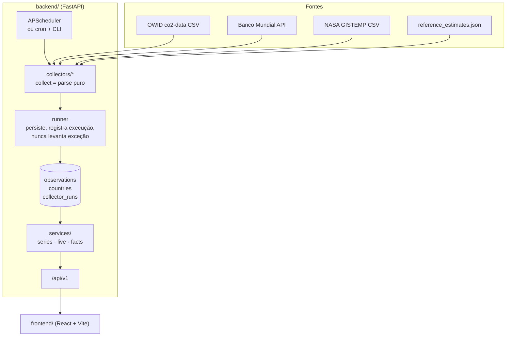

# Arquitetura

Visão técnica do World Data View: como os dados entram, onde ficam e como chegam à tela.

## Visão geral



## Backend (`backend/app`)

| Caminho | Responsabilidade |
|---|---|
| `indicators.py` | **Catálogo**: 13 indicadores e 5 categorias (slug, nome, unidade, descrição, fonte, `kind` medido ou estimativa, casas decimais, se tem série por país). É a fonte da verdade que a API e a interface leem. |
| `db/models.py` | `Observation` (indicador, país ISO3, ano, valor, fonte, `fetched_at`; único por indicador+país+ano), `Country`, `CollectorRun`. O mundo é o país `WLD`. |
| `db/session.py` | Engine/sessões. SQLite com WAL por padrão, PostgreSQL via `WDV_DATABASE_URL`. |
| `collectors/` | Um coletor por fonte. `collect()` é **puro** (recebe um cliente HTTP, devolve linhas e avisos) e por isso é testável com fakes. `runner.py` persiste com *upsert*, registra a execução em `collector_runs` e **nunca propaga exceção**: falha de rede vira aviso e as demais fontes seguem. |
| `services/series.py` | Consultas: séries, últimos pontos, valores por país, anos disponíveis. |
| `services/live.py` | Contadores ao vivo. |
| `services/facts.py` | Curiosidade do dia. |
| `services/demo.py` | Dados sintéticos de demonstração (`source="DEMO"`). |
| `services/cache.py` | Cache em memória com TTL para respostas pesadas. É limpo a cada coleta. |
| `api/routes.py` | Rotas sob `/api/v1`. |
| `scheduler.py` | APScheduler em processo (opcional). |
| `cli.py` | `init-db`, `collect`, `seed-demo`, `status`. |

### Modelo de dados

Uma tabela estreita e normalizada em vez de uma tabela por indicador:

```
observations(id, indicator, country, year, value, source, fetched_at)
UNIQUE (indicator, country, year)
```

Vantagens: indicador novo não exige migração, consultas de série e de mapa são o mesmo `SELECT`, e a procedência (`source`, `fetched_at`) acompanha cada número. O *upsert* usa `ON CONFLICT DO UPDATE` específico de cada dialeto (SQLite e PostgreSQL), então recoletar é idempotente.

### Como adicionar um indicador

1. Cadastre-o em `app/indicators.py` (slug, categoria, unidade, fonte, `kind`).
2. Faça um coletor existente emiti-lo, ou crie um novo em `collectors/` e registre-o em `COLLECTORS` (`runner.py`).
3. Se a unidade pedir escala diferente na tela (bilhões, milhões), ajuste `OVERRIDES` em `frontend/src/lib/display.ts`.
4. Adicione fixture e teste em `backend/tests/test_collectors.py`.

A interface descobre categorias e indicadores pela API; não há lista a atualizar no frontend além do texto de apresentação de cada categoria.

## Contadores ao vivo

O desenho original previa WebSockets. Como os dados de origem mudam uma vez por ano, empurrar um valor por segundo pelo servidor não traria informação. Em vez disso:

1. `GET /api/v1/live` devolve, para cada contador, um **valor-base**, um **ritmo por segundo**, o instante `as_of` e o ano dos dados em que se baseia.
2. O navegador calcula `base + ritmo × (agora − as_of)` e redesenha 10 vezes por segundo.

Detalhes de cálculo (`services/live.py`):

- **População**: o dado anual é ancorado em 1º de julho (meio do ano) e extrapolado pela taxa de crescimento do último intervalo.
- **Nascimentos e mortes**: taxa bruta (por mil) × população ÷ segundos por ano (`365,25 × 86.400`). Contam desde 00:00 UTC do dia.
- **CO₂ e variação florestal**: total anual ÷ segundos por ano; contam desde 1º de janeiro (UTC).
- Um contador só aparece se houver os dados para calculá-lo. Se a entrada for de demonstração, o contador carrega `is_demo`.

São **projeções**, não medições instantâneas. A interface diz isso ao lado do número e em "Como esses números são calculados".

Para leitores de tela, o número que corre fica `aria-hidden` e há um valor fixo equivalente, para que o anúncio não reinicie dez vezes por segundo.

## Curiosidade do dia

Cada gerador em `services/facts.py` monta uma frase a partir dos dados atuais do banco (ex.: crescimento da população desde 1950, CO₂ per capita, anomalia de temperatura). Os que têm dados formam a lista do dia e a escolha é `ordinal_do_dia % len(lista)`: **determinística por dia UTC** e rotativa. Cada fato informa se é estimativa (`is_estimate`) e se usa dado de demonstração (`is_demo`).

## Frontend (`frontend/src`)

| Caminho | Conteúdo |
|---|---|
| `App.tsx` | Estado global (período, entidades comparadas, cores) e carregamento de dados. |
| `api/` | Cliente tipado da API (`client.ts`, `types.ts`). |
| `hooks/` | `useAsync` (carregamento/erro, mantém o dado anterior atenuado durante recarga), `useNow`, `useTheme`. |
| `lib/` | Funções puras e testadas: formatação pt-BR, escalas do mapa, normalização Índice 100, atribuição de cores. |
| `components/` | `LiveSection`, `CategorySection`, `LineChart`, `ChoroplethMap`, `RankedBars`, `DataTable`, `FilterBar`, `Notices`, `SiteChrome`. |
| `index.css` | Tokens de cor e tipografia (Tailwind v4, `@theme`), temas claro/escuro. |

### Decisões de visualização

- **Gráfico de linhas em SVG próprio** (d3-scale + d3-shape): cursor com tooltip, rótulos diretos nas pontas quando não colidem, legenda para 2 ou mais séries, setas do teclado para percorrer os anos, **tabela equivalente** e CSV. Toda informação do tooltip está também na tabela.
- **Um só eixo Y**, sempre. Para comparar entidades de escala muito diferente (Brasil × mundo) existe o modo **Índice 100**, em vez de eixo duplo.
- **A cor segue a entidade, não a posição**: remover um país não repinta os demais (`assignSlots`). Máximo de 4 entidades, usando paleta categórica validada para daltonismo.
- **Mapa coroplético** com classes por quantis e rampa sequencial de um só matiz. No tema escuro a rampa inverte (mais claro = maior valor). O ranking ao lado dá a leitura exata.
- Estados de erro e vazio explicam o que houve e o que fazer; nada de painel em branco.

## Decisões deliberadas (e seus limites)

- **SQLite por padrão**: ótimo para uma instância. Se houver várias réplicas escrevendo, use PostgreSQL e desligue o agendador interno (rode `python -m app.cli collect` por cron).
- **Cache em memória**: não é compartilhado entre processos. Aceitável porque os dados mudam por coleta, e o cache é invalidado após cada uma.
- **API somente leitura** (CORS apenas `GET`). Não há autenticação nem limite de requisições; veja o roadmap.
