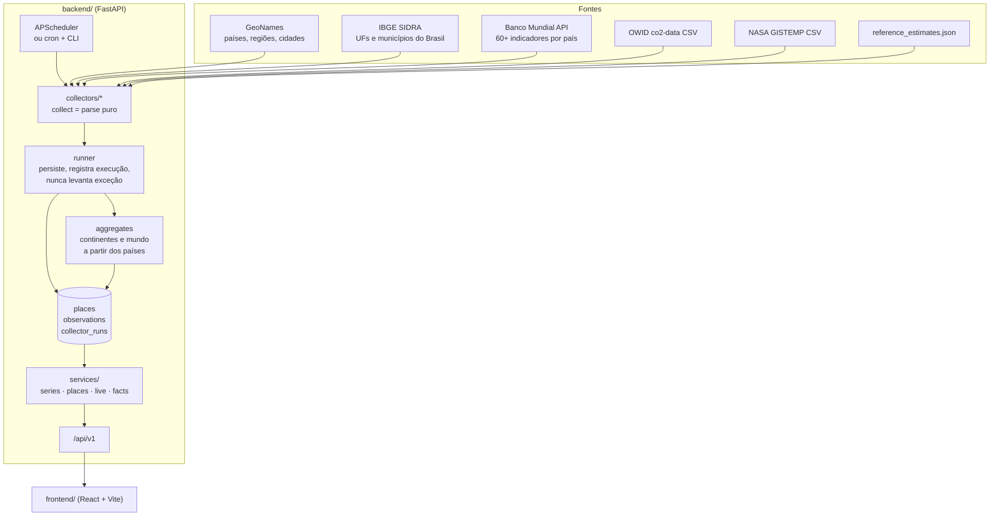

# Arquitetura

Visão técnica do World Data View: como os dados entram, onde ficam e como chegam à tela.

## Visão geral



## Backend (`backend/app`)

| Caminho | Responsabilidade |
|---|---|
| `indicators.py` | **Catálogo**: 230 indicadores em 9 categorias (slug, nome, unidade, descrição, fonte, `kind` medido ou estimativa, casas decimais, se tem série por lugar, código do Banco Mundial e regra de agregação). É a fonte da verdade que a API e a interface leem. |
| `places.py` | Tipos de lugar, identificadores (`WLD`, `CON-SA`, `BRA`, `BRA-SC`, `BRA-4209102`, `GEO-…`), continentes, as 27 UFs e a normalização de busca (minúsculas, sem acento). |
| `db/models.py` | `Place` (lugar, hierarquia, população mais recente e ficha), `Observation` (indicador, lugar, ano, valor, fonte, `fetched_at`; único por indicador+lugar+ano), `CollectorRun`. |
| `db/session.py` | Engine/sessões. SQLite com WAL por padrão, PostgreSQL via `WDV_DATABASE_URL`. `init_db` também migra bancos antigos (coluna `country` → `place`, tabela `countries` → `places`) e semeia o mundo e os continentes. |
| `collectors/` | Um coletor por fonte: `geonames`, `owid`, `worldbank`, `ibge`, `wikidata`, `gistemp`, `reference`. `collect()` é **puro** (recebe um cliente HTTP, devolve linhas, lugares e avisos) e por isso é testável com fakes. `runner.py` persiste com *upsert*, registra a execução em `collector_runs` e **nunca propaga exceção**: falha de rede vira aviso e as demais fontes seguem. Depois de todos, roda a etapa `aggregates`. |
| `services/series.py` | Consultas: séries (com as fontes de cada uma), últimos pontos, valores por país, anos disponíveis. |
| `services/places.py` | Busca, trilha do mundo até o lugar, filhos, métricas de um lugar e rankings. |
| `services/aggregate.py` | Continentes (e o mundo, quando a fonte não traz) calculados a partir dos países; veja [Agregados](#agregados-continentes-e-mundo). |
| `services/live.py` | Contadores ao vivo. |
| `services/facts.py` | Curiosidade do dia. |
| `services/demo.py` | Dados sintéticos de demonstração (`source="DEMO"`). |
| `services/cache.py` | Cache em memória com TTL para respostas pesadas. É limpo a cada coleta. |
| `api/routes.py` | Rotas sob `/api/v1`. |
| `scheduler.py` | APScheduler em processo (opcional). |
| `cli.py` | `init-db`, `collect [--only …]`, `seed-demo`, `status`. |

### Modelo de dados

Duas tabelas principais, estreitas e normalizadas, em vez de uma tabela por indicador:

```
places(id, kind, name, name_search, parent_id, country_id, iso2, lat, lon,
       population, population_year, population_source, info, info_source)
observations(id, indicator, place, year, value, source, fetched_at)
UNIQUE (indicator, place, year)
```

Vantagens: indicador novo não exige migração, consultas de série, mapa e ranking são o mesmo `SELECT`, e a procedência (`source`, `fetched_at`) acompanha cada número. O *upsert* usa `ON CONFLICT DO UPDATE` específico de cada dialeto (SQLite e PostgreSQL), então recoletar é idempotente.

#### Lugares

Todo dado pertence a um lugar. Identificadores curtos e legíveis; a hierarquia (`parent_id`) é mundo → continente → país → estado/região → cidade:

| Tipo | Identificador | Fonte |
|---|---|---|
| mundo | `WLD` | semeado |
| continente | `CON-AF`, `CON-AS`, `CON-EU`, `CON-NA`, `CON-SA`, `CON-OC` | semeado (a Antártida não tem habitantes fixos e fica de fora) |
| país | ISO 3166-1 alfa-3 (`BRA`) | GeoNames (`countryInfo`), com capital, área, moeda, idiomas; Banco Mundial acrescenta faixa de renda |
| estado/região | `BRA-SC` (UFs do IBGE), `USA-CA` (divisão administrativa de 1º nível do GeoNames; nascem das cidades de 5.000+ habitantes ou, quando só o Wikidata tem a população, da própria divisão) | IBGE; GeoNames (nome e hierarquia); Wikidata (população) |
| cidade | `BRA-4209102` (município do IBGE), `GEO-5128581` (GeoNames) | IBGE (5.571 municípios); GeoNames `cities5000` (cidades com mais de 5.000 habitantes) |

`Place.population` guarda o **último valor conhecido** de cada lugar (com ano e fonte) para listar e ranquear sem varrer `observations`. Nas cidades do GeoNames ele é um instantâneo **sem ano de referência**, e a interface diz isso. O Brasil vem inteiro do IBGE (o GeoNames pula as cidades brasileiras) para não duplicar municípios.

Fora do Brasil há série histórica completa só para países, continentes e mundo. Estados e regiões de outros países têm a população que o Wikidata registra, com a data de cada censo ou estimativa (poucos pontos por região, não uma série anual); cidades de outros países têm população (instantâneo do GeoNames) e ficha.

#### Agregados: continentes e mundo

Continentes não têm fonte própria: `services/aggregate.py` os calcula a partir dos países, só para indicadores com regra no catálogo (`agg`: soma ou média ponderada pela população). Regras para nunca inventar um número:

- um ano só entra se os países que informaram somam ao menos **95%** (soma) ou **90%** (média) da população atual do grupo;
- a média usa a população do próprio ano (ou do ano anterior mais próximo, até 5 anos antes);
- o mundo que a própria fonte publica nunca é sobrescrito; só se calcula o mundo quando a fonte não traz;
- linhas calculadas têm `source` começando por `Derivado: `, e a interface as marca como **calculado**;
- linhas de demonstração (`DEMO`) nunca entram na conta;
- razões que não se somam nem se ponderam (Gini, % do PIB) ficam sem dado nos continentes.

### Como adicionar um indicador

1. Cadastre-o em `app/indicators.py`. Para um indicador do Banco Mundial use o auxiliar `_wb(slug, código, nome, categoria, unidade, descrição, ...)`: o coletor `worldbank` já o baixa para todos os países. Passe `agg=AGG_SUM` ou `AGG_POP_MEAN` se o continente puder ser somado ou ponderado por população.
2. Para outra fonte, faça um coletor existente emiti-lo, ou crie um novo em `collectors/` e registre-o em `COLLECTORS` (`runner.py`).
3. Se o valor **mundial** pedir escala diferente na tela (bilhões, milhões), ajuste `OVERRIDES` em `frontend/src/lib/display.ts`. Lugares usam a unidade da fonte (veja `mapFormat`).
4. Antes de cadastrar um código do Banco Mundial, baixe `https://api.worldbank.org/v2/en/indicator/{código}?downloadformat=csv` (num runner com internet; veja [verificação real](fontes-de-dados.md#como-as-fontes-foram-verificadas)) e confira país a país: quantos países têm dado, o último ano e se o mundo vem na fonte. Descarte o que for esparso ou antigo.
5. Adicione fixture e teste em `backend/tests/` (`test_collectors.py` para o Banco Mundial e a OWID); `test_catalog.py` confere unicidade, categoria e coerência da agregação.

A interface descobre categorias e indicadores pela API; não há lista a atualizar no frontend além do texto de apresentação de cada categoria.

## Contadores ao vivo

O desenho original previa WebSockets. Como os dados de origem mudam uma vez por ano, empurrar um valor por segundo pelo servidor não traria informação. Em vez disso:

1. `GET /api/v1/live` devolve, para cada contador, um **valor-base**, um **ritmo por segundo**, o instante `as_of` e o ano dos dados em que se baseia.
2. O navegador calcula `base + ritmo × (agora − as_of)` e redesenha 10 vezes por segundo.

Detalhes de cálculo (`services/live.py`):

- **População**: o dado anual é ancorado em 1º de julho (meio do ano) e extrapolado pela taxa de crescimento do último intervalo.
- **Nascimentos e mortes**: taxa bruta (por mil) × população ÷ segundos por ano (`365,25 × 86.400`). Contam desde 00:00 UTC do dia.
- **CO₂ e variação florestal**: total anual ÷ segundos por ano; contam desde 1º de janeiro (UTC).
- Um contador só aparece se houver os dados para calculá-lo. Se a entrada for de demonstração, o contador carrega `is_demo`.

São **projeções**, não medições instantâneas. A interface diz isso ao lado do número e em "Como esses números são calculados".

Para leitores de tela, o número que corre fica `aria-hidden` e há um valor fixo equivalente, para que o anúncio não reinicie dez vezes por segundo.

## Curiosidade do dia

Cada gerador em `services/facts.py` monta uma frase a partir dos dados atuais do banco (ex.: crescimento da população desde 1950, CO₂ per capita, anomalia de temperatura). Os que têm dados formam a lista do dia e a escolha é `ordinal_do_dia % len(lista)`: **determinística por dia UTC** e rotativa. Cada fato informa se é estimativa (`is_estimate`) e se usa dado de demonstração (`is_demo`).

## Frontend (`frontend/src`)

| Caminho | Conteúdo |
|---|---|
| `App.tsx` | Rota (hash), período, lugares comparados e carregamento de dados. |
| `api/` | Cliente tipado da API (`client.ts`, `types.ts`). |
| `hooks/` | `useAsync` (carregamento/erro, mantém o dado anterior atenuado durante recarga), `useComparison` (lugares comparados com cor estável), `useHashRoute`, `useNow`, `useTheme`. |
| `lib/` | Funções puras e testadas: formatação pt-BR (por nível: mundo × lugar), escalas do mapa, Índice 100, cores, `places.ts` (nomes em português, rotas, busca local, agrupamento de métricas, ficha) e `sources.ts` (códigos de fonte → texto). |
| `components/` | `LiveSection`, `PlacesExplorer`, `CategorySection`, `HistoryPanel` (gráfico/tabela/CSV de um indicador para N lugares), `PlacePage`, `PlaceSearch` (combobox acessível), `LineChart`, `Sparkline`, `ChoroplethMap`, `RankedBars`, `DataTable`, `FilterBar`, `Notices`, `SiteChrome`. |
| `index.css` | Tokens de cor e tipografia (Tailwind v4, `@theme`), temas claro/escuro. |

### Páginas e rotas

A interface usa rota por *hash*, o que dispensa configuração de servidor em hospedagem estática: `#/` é o painel e `#/lugar/{id}` é a página de um lugar (`#/lugar/BRA-SC`). A página do lugar mostra a trilha mundo → … → lugar, a população (com ano e fonte), a ficha, o gráfico de evolução com comparação de até 4 lugares, o ranking dos lugares contidos e todos os indicadores com dado ali.

Nomes de países, continentes e do mundo são traduzidos no navegador (`i18n-iso-countries` e uma tabela de continentes); estados e cidades usam o nome da fonte. A busca de países e continentes roda no navegador; estados e cidades vêm de `/places/search`.

### Decisões de visualização

- **Gráfico de linhas em SVG próprio** (d3-scale + d3-shape): cursor com tooltip, rótulos diretos nas pontas quando não colidem, legenda para 2 ou mais séries, setas do teclado para percorrer os anos, **tabela equivalente** e CSV. Toda informação do tooltip está também na tabela.
- **Um só eixo Y**, sempre. Para comparar entidades de escala muito diferente (Brasil × mundo) existe o modo **Índice 100**, em vez de eixo duplo.
- **A cor segue a entidade, não a posição**: remover um lugar não repinta os demais (`assignSlots`). Máximo de 4 entidades, usando paleta categórica validada para daltonismo.
- **Origem sempre visível**: cada série informa suas fontes; selos marcam *estimativa*, *demonstração* e *calculado*. Quando a origem dos pontos difere da fonte geral do indicador (um município do IBGE num indicador do Banco Mundial), há uma linha própria.
- **Unidades por nível**: o mundo usa conversões legíveis (CO₂ em bilhões de t); países, estados e cidades usam a unidade da fonte, senão virariam "0,0".
- **Mapa coroplético** com classes por quantis e rampa sequencial de um só matiz. No tema escuro a rampa inverte (mais claro = maior valor). O ranking ao lado dá a leitura exata.
- Estados de erro e vazio explicam o que houve e o que fazer; nada de painel em branco.

## Decisões deliberadas (e seus limites)

- **SQLite por padrão**: ótimo para uma instância. Se houver várias réplicas escrevendo, use PostgreSQL e desligue o agendador interno (rode `python -m app.cli collect` por cron).
- **Cache em memória**: não é compartilhado entre processos. Aceitável porque os dados mudam por coleta, e o cache é invalidado após cada uma.
- **API somente leitura** (CORS apenas `GET`). Não há autenticação nem limite de requisições; veja o roadmap.
